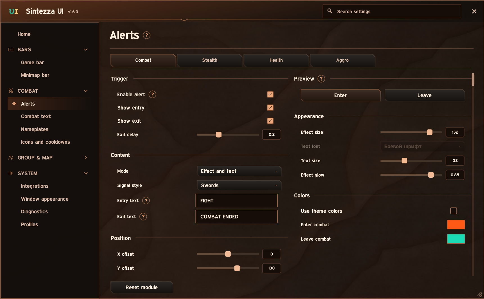
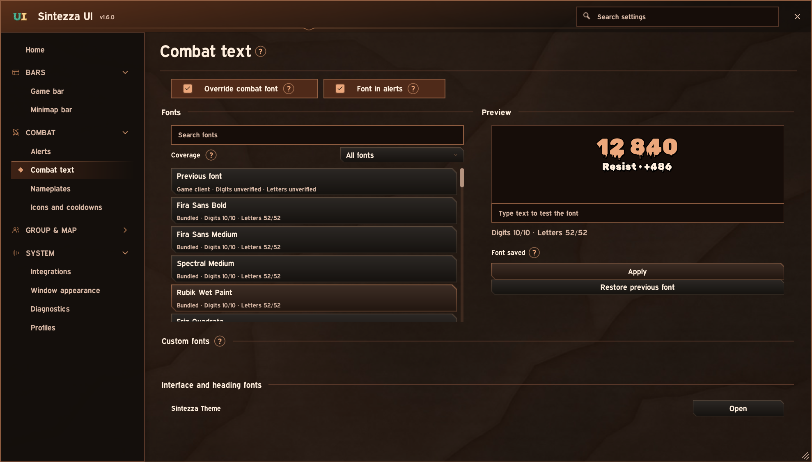
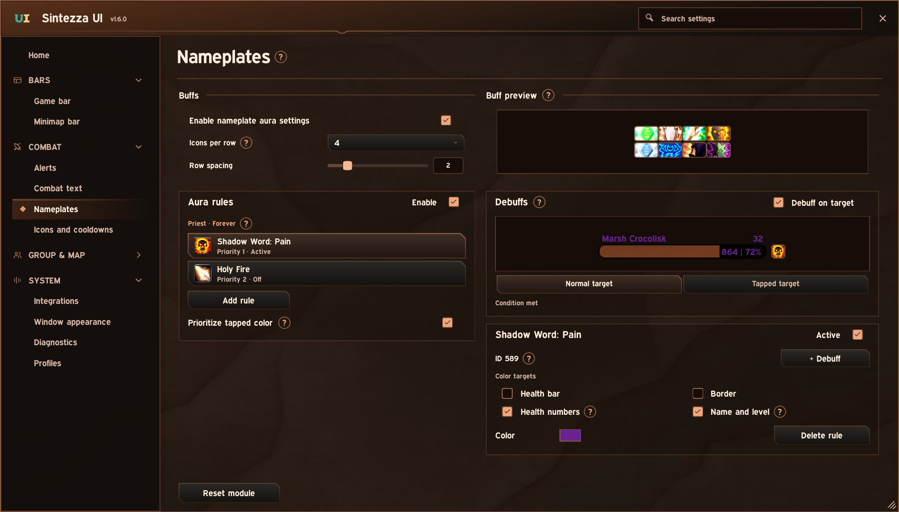
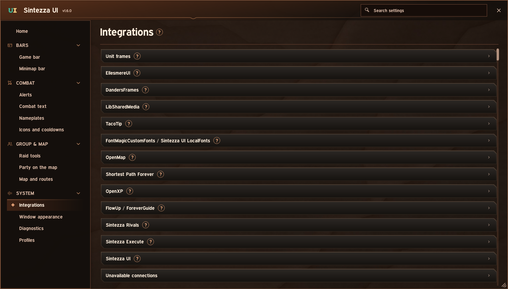
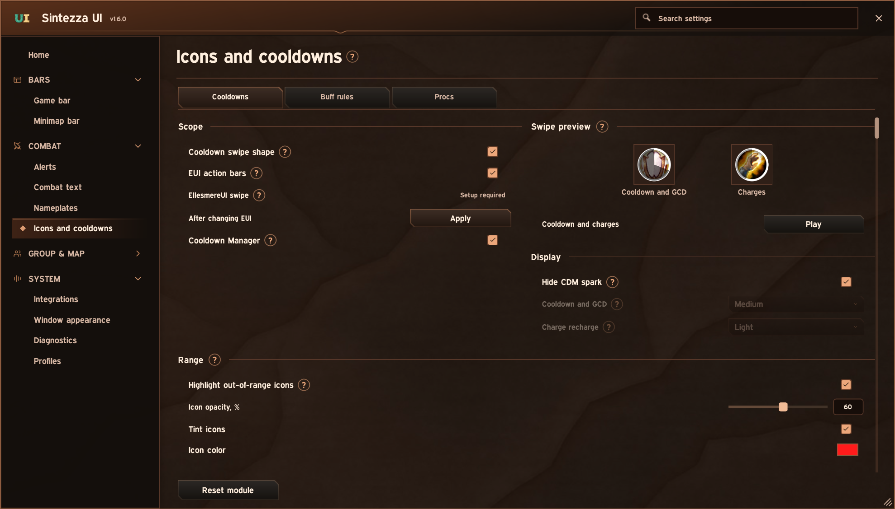
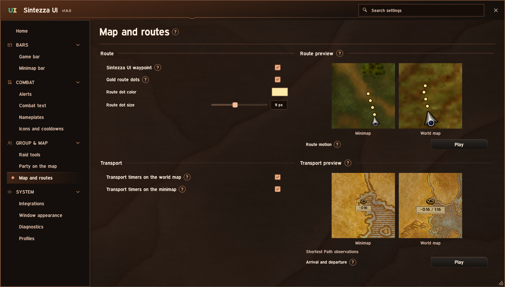
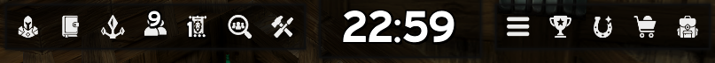

# Sintezza UI

| CurseForge field | Value |
| --- | --- |
| Game | World of Warcraft |
| Class | Addons |
| Flavor and version | Forever 1.60.1 |
| Main category | Miscellaneous |
| Additional categories | Action Bars, Unit Frames, Combat, Map & Minimap |
| CurseForge relations | Sintezza Theme (Required Dependency, project 1810657) |
| Project license | MIT. See the repository for third-party notices. |

## Summary

Combat alerts, combat font replacement, nameplate debuff colors, and addon fixes for WoW Forever.

## Description

Sintezza UI adds combat alerts, combat text fonts, and debuff color rules to WoW Forever. Open `/sui` to enable the modules you want. If you already use other UI addons, **System → Integrations** shows the changes available for each one.

### Combat, stealth, health, and aggro alerts

Choose a signal and preview it at its in-game position. Each alert has its own settings.

Set your own captions, effect, size, position, and colors for combat and stealth. Use the theme palette or pick your own colors. Combat badges and flags can use your faction's emblem. Low-health alerts have an adjustable threshold, and the aggro alert applies in dungeons and raids.

### Replace your combat font

Look up a font by name, check which characters it covers, and try it with your own sample text.

Open `/sui fonts` to search the catalog and filter for full Cyrillic coverage. Preview numbers and type your own sample. Use built-in fonts, SharedMedia, or your own TTF files in the 20 numbered slots in `Media/CombatFonts/Custom`. Apply the font to Sintezza alerts separately. Log out to character selection and back in to update damage numbers above targets. [Personal font setup](https://github.com/ArtefactoO/Sintezza_UI#combat-text)

### Color nameplates when debuffs apply

This Shadow Word: Pain example colors the target name and health numbers. You can also choose the bar or border on supported nameplates.

Create rules for one or two debuffs and decide what to color. Supported rules can change the health bar and border. With EllesmereUI, you can also color the name, level, and health numbers. For example, use one color for Shadow Word: Pain and a higher-priority rule for when both tracked debuffs are present. Buff row limits and spacing can be set separately.

### Small addon fixes and integrations

Open an addon in System → Integrations to see what Sintezza can change and which features are available.

Each fix uses the addon and client features listed below. Open the integration group for its switch, requirements, and status.

| Addon | What Sintezza UI adds |
| --- | --- |
| [EllesmereUI](https://www.curseforge.com/wow/addons/ellesmereui) | Buff wrapping and debuff colors on nameplates. Shaped cooldown and charge swipes, range tint, and XP-bar corners on action bars. Compatible stack alerts, swipes, and glows in Cooldown Manager and Aura Buff Reminders. Per-frame corners and borders for supported unit, raid, and resource frames. Optional number formatting, talent and spellbook shortcuts, shared glow, and combat font support. |
| Blizzard nameplates | Optional buff wrapping into one or two rows with native aura filtering. |
| [DandersFrames](https://www.curseforge.com/wow/addons/danders-frames) | Separate party and raid borders, supported rounded layers, and absorb-bar spacing for compatible glow presets. |
| [Does It Die Advanced](https://www.curseforge.com/wow/addons/does-it-die-advanced) | Clip DoT forecasts to supported rounded EllesmereUI frames and nameplates. |
| [TacoTip](https://www.curseforge.com/wow/addons/tacotip-gearscore) | Match the item-level and GearScore footer to the selected interface font. |
| [LibSharedMedia](https://www.curseforge.com/wow/addons/libsharedmedia-3-0) and [SharedMediaAdditionalFonts](https://www.curseforge.com/wow/addons/shared-media-additional-fonts) | Share compatible fonts and textures. Register fonts with verified Cyrillic coverage for DandersFrames. |
| [FontMagic](https://www.curseforge.com/wow/addons/fontmagic), FontMagicCustomFonts, and Sintezza UI Local Fonts | Report combat-font ownership and find existing personal font slots. |
| [OpenMap](https://www.curseforge.com/wow/addons/openmap) | Show party positions and personal waypoints on the stitched world map. |
| [Shortest Path Forever](https://www.curseforge.com/wow/addons/shortest-path-forever) and [WaypointUI](https://www.curseforge.com/wow/addons/waypointui) | Route to personal waypoints, show walking dots and supported transport timers, and clear compatible navigation when a waypoint is cleared. |
| [OpenXP](https://www.curseforge.com/wow/addons/openxp-free-leveling-guides-for-wow-forever), [QuestieDB](https://www.curseforge.com/wow/addons/questiedb), and [RestedXP](https://www.curseforge.com/wow/addons/restedxp-guide) | Localize supported OpenXP text on the Russian client and route to its current step through Shortest Path. An active RestedXP guide keeps ownership of its route. |
| [FlowUp](https://www.curseforge.com/wow/addons/flowup-forever), [ForeverGuide](https://www.curseforge.com/wow/addons/foreverguide), and [TomTom](https://www.curseforge.com/wow/addons/tomtom) | Adopt supported single guide destinations as waypoints, including compatible fallback markers when standalone TomTom is absent. |
| [Sintezza Rivals](https://github.com/ArtefactoO/Sintezza_Rivals), [Execute](https://github.com/ArtefactoO/Sintezza_Execute), and [Perf](https://github.com/ArtefactoO/Sintezza_Perf) | Dock the Rivals map button, offer Execute its old Sintezza UI marker appearance on first setup, and expose transport timer profiling in Perf. |

An optional chat filter quiets missing-recipient errors matched to supported addon whispers. Use `/sui whisperlog` to see which sender was identified.

Preview the cooldown and charge swipes in EllesmereUI and adjust how out-of-range abilities look.

### Waypoints and transport timers

Preview the Shortest Path route dots and supported transport countdowns on both maps.

An OpenXP step can become a Shortest Path destination when guide following and Sintezza waypoints are enabled. Ctrl + left-click sets your own waypoint. The map settings also offer walking dots, transport timers, and a route preview.

### Game bar and raid controls

Put system shortcuts around the clock. Reorder, replace, or hide the buttons in the layout editor.

The minimap bar can display friends, guild, frame rate, and latency. **Raid tools** supplies target and world markers, pull countdowns, ready checks, and pings. Enable each module in `/sui`.

### Appearance and requirements

**Requires [Sintezza Theme](https://github.com/ArtefactoO/Sintezza_Theme).** Use `/stheme` to change the palette, fonts, button styles, and background. Addon integrations are optional and need their respective addons. See the [compatibility notes](https://github.com/ArtefactoO/Sintezza_UI#validation-and-known-issues) for supported layers and limitations.

<!-- Changelog field -->

### Changelog

[View the release history on GitHub](https://github.com/ArtefactoO/Sintezza_UI/blob/main/CHANGELOG.md).

Source, installation details, and credits are available on [GitHub](https://github.com/ArtefactoO/Sintezza_UI).
