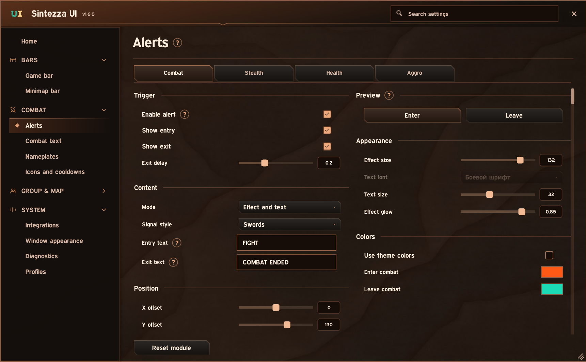
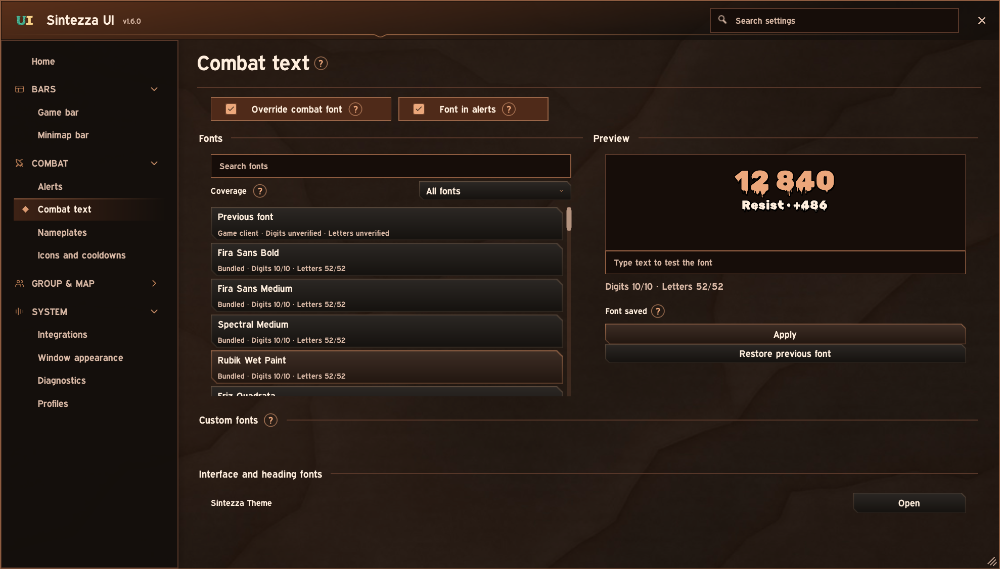
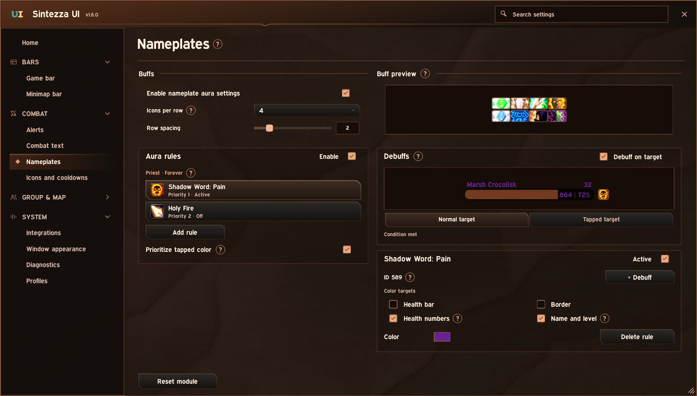
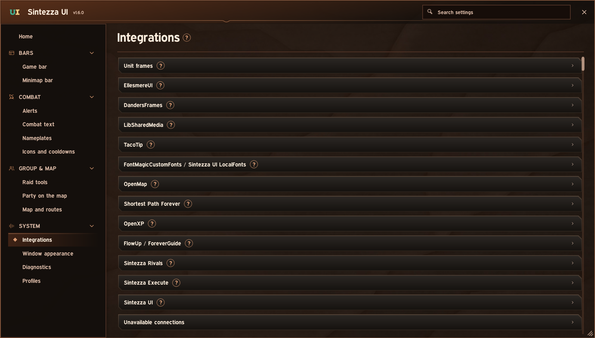
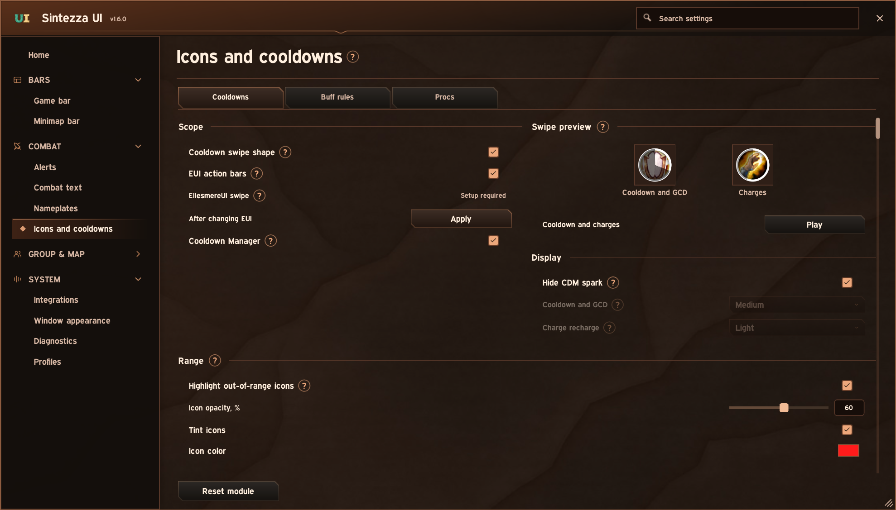
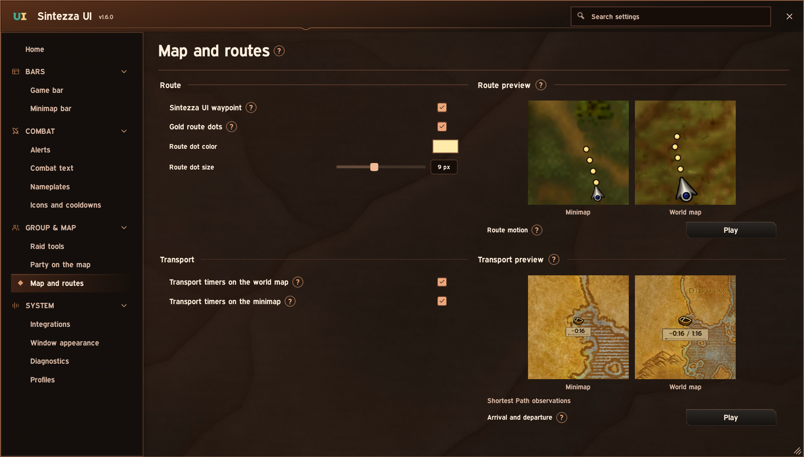
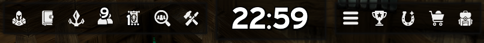
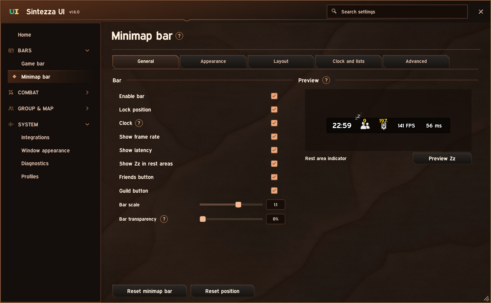
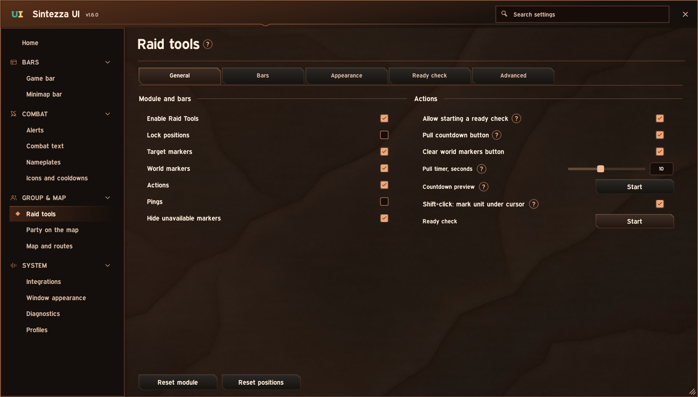

# Sintezza UI


Sintezza UI adds a game bar, combat and stealth alerts, raid tools, and map and nameplate controls to WoW Forever. It also extends the addons already handling your interface, including EllesmereUI, DandersFrames, OpenMap, and OpenXP. Open `/sui` to configure the modules and manage profiles.

## Installation

Install Sintezza UI and the required **[Sintezza Theme](https://github.com/ArtefactoO/Sintezza_Theme)** as separate folders in `Interface/AddOns`, then enable both. This project targets WoW Forever. Execute thresholds and markers are available separately in **Sintezza Execute**.

New Forever profiles start with the game bars, alerts, raid tools, frame compatibility, nameplate extensions, and cooldown masks disabled. Enable the modules you want in `/sui`.

## Appearance

Open `/stheme` to choose the shared palette, interface font, heading font, and language. Sintezza Theme also supplies the shared color controls. The available picker controls depend on the Theme version and the setting.

## What it adds

- Game bar with system shortcuts, friends, guild, and a clock.
- Combat and stealth alerts with configurable text, graphics, and motion.
- Raid markers, ready checks, and pull controls.
- Group markers, personal waypoints, and transport timers when the map provides the data.
- Nameplate buff rows and debuff color rules.
- Combat font selection and previews, with shared interface and heading fonts managed in Sintezza Theme.

## Alerts

Under **Alerts**, choose swords, a crest, a slash, a flag, brackets, or a side panel. The combat crest and flag use your character's faction emblem when available. The **Stealth** tab has a separate style picker with the Squint eye, footprints, a mask, and mist among its options. Edit the four messages for combat and stealth and preview them at their in-game positions. Signals can follow the active theme palette or use the manual colors stored in the profile.

The **Health** and **Aggro** tabs offer opt-in alerts with their own styles, captions, theme or manual colors, size, position, and preview. The health alert triggers when your health crosses the configured threshold and rearms once it recovers. The aggro alert triggers when you start holding enemy aggro in a dungeon or raid and rearms when you lose it. Both depend on the client making the readings available to addons.

| Command | Opens |
| --- | --- |
| `/sui` | Settings and profiles |
| `/sui fonts` | Combat text font and preview |
| `/sui report` | Client, module, and error diagnostics |
| `/sui npstatus` | Nameplate diagnostics |
| `/sui dida` | Does It Die Advanced mask diagnostics for the selected nameplate |
| `/sui whisperlog` | Recent filtered addon whisper errors and their sources |
| `/sgb` | Game bar controls |
| `/srt` | Raid tools controls |
| `/stheme` | Interface and heading fonts, palettes, and language |

## Combat text

Open `/sui fonts`, select a font in the preview, and click **Apply**. **Use font in Sintezza alerts** applies the choice to combat and stealth alerts immediately. Clear that option to use the fonts set in the alert module. To update numbers above targets after applying or restoring a font, return to character selection and log back in.

An enabled Sintezza override takes priority over the EllesmereUI combat font. The font settings flag when FontMagic controls combat numbers. The catalog includes WoW, Sintezza Theme, LibSharedMedia, and personal fonts. Search by font name or use **Coverage** to show fonts with a complete Russian alphabet. The catalog reports coverage for digits and letters. The Russian filter checks 66 Cyrillic letters. Entries without coverage data are marked unverified.

To add a personal font, put a copy in `Sintezza_UI/Media/CombatFonts/Custom` under a name from `1.ttf` to `20.ttf`, then restart WoW. The repository's optional tool `Tools/IndexCombatFonts.py` reads font names and Unicode coverage and can also index existing FontMagicCustomFonts slots. Run it again after replacing any numbered file. Its output and font copies live in the local `Sintezza_UI_LocalFonts` addon.

From the repository root, run the tool with the path to your own Forever installation.

```powershell
$addons = 'D:\Games\World of Warcraft\_forever_\Interface\AddOns'
python .\Tools\IndexCombatFonts.py $addons --output $addons
```

## Nameplate debuff colors

Open **Combat → Nameplates** to add a rule for one or two debuffs. Set its priority and choose a color for the health bar or border on supported plates. With EllesmereUI Nameplates, rules can also color the name, level, and health numbers. Use the normal and tapped target previews to check how that rule interacts with tapped-target priority. Buff wrapping and spacing have their own controls.

## Addon integrations

The optional Sintezza Perf addon adds **Transport timers** to `/sperf dev`, with point-level timings for departure calculations and refresh counts for the world map and minimap.

Use the search field at the top of `/sui` to find module pages and common settings. Profiles are at the bottom of **System**. Open **System → Integrations** to check optional dependencies and manage the Sintezza adapters. Click an addon name to expand or collapse its settings. The page shows when an addon or module is missing or disabled, an API or client is incompatible, or a change is pending a UI reload or character relog.

### Examples

**EllesmereUI nameplate example.** Set an aura rule for your specialization, then choose whether it colors the health bar, border, or supported text. A rule can require two debuffs and color multiple supported channels.

**OpenXP and Shortest Path example.** Enable the Sintezza waypoint and guide following in Shortest Path. When OpenXP advances to a supported step with a destination, Sintezza can pass that point to Shortest Path and use its walking route. The active OpenXP pointer can be hidden during routing and restored when the route ends.

### EllesmereUI

- **Nameplates.** Preview buff rows and debuff color rules on one page. EllesmereUI and stock Forever nameplates support custom buff wrapping and spacing. Stock wrapping uses Blizzard's aura filters and caps the display at two rows. Debuff rules can combine two effects and color the health bar and border. Text coloring uses EllesmereUI nameplates.
- **Action Bars.** **Icons and cooldowns → Cooldowns** adds shaped cooldown, GCD, and charge-recharge swipes with separate shading. Set **CD Swipe Opacity** to **0** in EllesmereUI and click **Apply** in Sintezza. On Forever, **Highlight out-of-range icons** can dim or tint icons on bars with EllesmereUI's **Out of Range Coloring** enabled.
- **Cooldown Manager.** Shape the swipes on supported icons, hide the cooldown spark, and add pulse, outline, or sound effects at up to four stack thresholds for a tracked buff. Rules can be limited to combat or grouped play. Proc effects can use a fill, outline, or both. Compatible procedural buff glows follow the icon shape selected in EllesmereUI.
- **Unit Frames, Raid Frames, Resource Bars, and the Action Bars experience bar.** **System → Integrations → Unit frames → General / By element** gives supported widgets a shared or per-widget square or rounded shape, radius, dimensions, and border controls. This includes the player, target, focus, target-of-target, pet, boss and group frames, nameplates, health and power bars, class resource, and XP bar, subject to each widget's supported controls. The XP bar can inherit corner settings from the primary resource bar. **Apply to all** writes a thin black border to the supported widgets in the active EllesmereUI and DandersFrames profiles.
- **Aura Buff Reminders.** Compatible procedural glows follow the outline of shaped reminder icons.
- **Damage Meters.** The optional adapter adds a fractional tier below 1 to the shared EUI number formatter. Current native DPS/HPS rows clamp readable per-second values to 1 before formatting, so this adapter cannot restore those fractions.
- **Forever Essentials.** Sintezza's talents and spellbook shortcuts use the EllesmereUI route when available, with the Blizzard micro buttons as fallback.
- **Shared glow.** The Game bar and Raid Check can use the EllesmereUI glow renderer for their own outlines when the glow border is selected.
- **Combat font.** The enabled Sintezza override takes priority over the EllesmereUI combat font. See **Combat text** above for the relog required by the numbers above targets.

Inspired by [EllesmereUI](https://www.curseforge.com/wow/addons/ellesmereui).

### DandersFrames, fonts, and other overlays

- **DandersFrames.** **System → Integrations → Unit frames → By element** edits the DandersFrames party and raid layouts separately in their active profiles. Pick a solid, gradient, or texture border and adjust thickness, outward offset, color source, and opacity. Rounded frames can carry the matching dispel outline and compatible aggro glow. **System → Integrations → DandersFrames → Absorb inset** keeps selected outer-glow presets from shrinking absorb and heal-absorb bars. [Danders Frames](https://www.curseforge.com/wow/addons/danders-frames)
- **LibSharedMedia and SharedMediaAdditionalFonts.** **System → Integrations → Unit frames → Fonts → Register fonts** adds verified Cyrillic coverage to the DandersFrames font registry. Latin support is registered when its full alphabet is verified. Use `/reload` after removing a registration. SharedMedia also supplies fonts for the combat font catalog and raid tools. **System → Integrations → Frame textures in SharedMedia** makes Sintezza's rounded glow and the Ellesmere glow available to media pickers when the corresponding addon is loaded. Only fonts with verified complete Russian coverage can be registered for DandersFrames. Unverified and incomplete fonts stay available for inspection in the catalog.
- **TacoTip.** On Forever, the item-level and GearScore labels and values in the compatible character-window footer use the Sintezza Theme interface font. TacoTip supplies the footer and the scores.
- **Does It Die Advanced.** Its DoT forecast can be clipped to the rounded silhouette of the EllesmereUI target frame and supported EllesmereUI nameplates. The forecast retains its own fill, outline, and animations. Use `/sui dida` with a visible target plate to diagnose the mask. [Does It Die Advanced](https://www.curseforge.com/wow/addons/does-it-die-advanced)
- **FontMagic and FontMagicCustomFonts.** Sintezza reports when FontMagic owns the combat numbers. Valid files in the FontMagicCustomFonts numbered slots can appear in the Sintezza catalog or be indexed by the optional tool above.

### Rounded DandersFrames coverage

Rounded styling supports Solid borders and the Sintezza thin rounded preset. Gradient and other textured presets use the DandersFrames renderer. The rounded layer reads the native border specification, including inset, offsets, thickness, opacity, and blend mode. The preview uses the same geometry helper.

| Frame content | Rounded handling |
| --- | --- |
| Background, health, and missing-health fill | Included in the body mask. |
| Absorb and heal-absorb bars | Their supported bars and fill textures are included. |
| Heal prediction and reduced maximum health | The existing fill textures are included. |
| Attached power bar | Shares the main frame's silhouette. A detached power bar is rounded separately. |
| Native square border artwork | Receives a suppression mask outside combat. Native visibility and color updates retain that mask. |
| Dispel indication | Compatible dispel gradients and rings have a separate shape adapter. |
| Aggro indication | Compatible Solid aggro highlights have a separate rounded outline. |
| Selection, hover, text, and icons | Keep their own rendering. Selection and hover effects can retain square corners. |

Masks are prepared outside combat. An already prepared frame keeps its masks during native border updates. A frame that first requires preparation during combat receives the adaptation after combat. A texture or overlay created later needs a subsequent supported refresh before it joins the mask.

The adapter checks whether frames and values are accessible. Restricted values are omitted from custom geometry, and unavailable cases use native DandersFrames rendering. The rounded layer does not derive its geometry from unit health or aura values.

### Maps, guides, and chat in WoW Forever

Find route and transport options under **Group & Map → Map and routes**, and teammate controls under **Party on the map**.

- **OpenMap.** Party positions and the party finder work on the stitched world map. Pick a teammate in the map menu to focus their marker, or their zone when only the zone is known. Sintezza's personal waypoint can be set from OpenMap as well as from the world-map canvas.
- **Shortest Path Forever.** **Sintezza UI waypoint** lets Ctrl + left-click set a personal waypoint and start a route through the compatible Shortest Path API. Ctrl + right-click clears the point and can also clear the temporary OpenMap pin and active **WaypointUI** user navigation. **Gold route dots** replaces the walking route display with animated gold dots on both maps. This visual option is off by default and is available when Sintezza can use the Shortest Path route renderer. The two transport timer options use Shortest Path observations to show arrival and departure countdowns beside supported dock markers, including on the stitched OpenMap view where available. `/sui report` reports route integration status and point counts. [Shortest Path Forever](https://www.curseforge.com/wow/addons/shortest-path-forever) · [OpenMap](https://www.curseforge.com/wow/addons/openmap)
- **OpenXP and Questie.** On the Russian Forever client, compatible OpenXP cards use Russian headings and standard step phrases. Matching quest, creature, object, item, and zone names are taken from client data, the OpenXP dictionary, or optional QuestieDB records. Free-form guide text keeps its original language. With the Sintezza personal waypoint and Shortest Path's RestedXP guide following enabled, Shortest Path can route to the current OpenXP step. Its **Hide RestedXP arrow** option can also hide the OpenXP pointer during that route, with visibility handed back when the journey ends. An active **RestedXP** integration keeps ownership of its own guide route. [OpenXP](https://www.curseforge.com/wow/addons/openxp-free-leveling-guides-for-wow-forever)
- **FlowUp and ForeverGuide.** With **Sintezza UI waypoint** turned on, compatible single guide destinations can become Sintezza waypoints and feed Shortest Path. The adapter also accepts supported temporary markers from their TomTom-compatible bridge when standalone **TomTom** is absent. Multi-point ForeverGuide batches stay with the original provider.
- **Addon whispers.** **System → Integrations → Sintezza UI → Hide addon whisper errors** filters missing-recipient errors matched to addon whispers when a manual whisper to the same player was absent. `/sui whisperlog` identifies known prefixes from ForeverGuide, FlowUp, OpenMap, and Shortest Path Forever, and shows the technical prefix for other tracked sends.

### Other Sintezza addons and Retail compatibility

- **Sintezza Rivals.** Its fight-marker toggle docks beneath the Sintezza UI party map button when the latter is visible.
- **Sintezza Execute.** The separate execute addon can import the saved appearance of the old execute marker from Sintezza UI when setting up its own database.
- **EllesmereUIQoL, Retail only.** Sintezza's dungeon teleport reminder defers to the EllesmereUIQoL **LFG Reminder** when that feature is active, avoiding a duplicate prompt.

## Validation and known issues

The first CurseForge package targets WoW Forever 1.60.1. See [CHANGELOG.md](CHANGELOG.md) for the release history. Recent source audits used installed EllesmereUI 9.8.8, DandersFrames 5.6.2, Shortest Path Forever 1.41.0, OpenMap 0.8.10, and OpenXP 1.3.65.

Lua syntax, targeted mocks, profile migration checks, and installed-file hash comparisons cover the recent changes. Real-client confirmation of the latest rounded DandersFrames masks, stock Blizzard buff wrapping, and combat/instance rendering remains pending.

The following source-review findings remain open before a stable release.

- **Action bar swipes and range colors.** Independent swipe hosts can outlive a parent panel's fade or its Loss of Control replacement. Additional range fading can replace the native EUI range color.
- **Guide and waypoint ownership.** The OpenXP pointer can be hidden while the Shortest Path arrow is disabled. Adopting a ForeverGuide point through the native TomTom-compatible bridge can interrupt the guide's subsequent route cleanup. Clearing a Sintezza waypoint can also clear another provider's active navigation.
- **Overlapping colors and map markers.** Native EllesmereUI debuff coloring and Sintezza aura rules can compete when they color the same channel. OpenMap's persistent group markers can overlap Sintezza markers.
- **Additional effects and frame previews.** Rounded coverage follows the table above. The raid-frame preview reads base dimensions while native raid-size overrides can select other dimensions. A forced rounded fallback can lose the native selection of individual corners.
- **Stock buff-row recovery.** A partial failure after native buff redraw can leave the visible icon count out of sync with restored layout fields.

The last audit also identified further compatibility work in tracked aura groups, resource-bar rebuilds during combat, and stack-effect ownership. Static and mock checks leave those live integration outcomes for confirmation.

## License

Sintezza's own source code is distributed under the [MIT License](LICENSE). Rubik Wet Paint uses the [SIL Open Font License 1.1](Media/CombatFonts/RubikWetPaint-OFL.txt). Transport schedules use data from [Shortest Path Forever](https://www.curseforge.com/wow/addons/shortest-path-forever). [Changelog](CHANGELOG.md)

## Gallery



Choose a signal and preview it at its in-game position. Each alert has its own settings.



Look up a font by name, check which characters it covers, and try it with your own sample text.



This Shadow Word: Pain example colors the target name and health numbers. You can also choose the bar or border on supported nameplates.



Open an addon in System → Integrations to see what Sintezza can change and which features are available.



Preview the cooldown and charge swipes in EllesmereUI and adjust how out-of-range abilities look.



Preview the Shortest Path route dots and supported transport countdowns on both maps.



Put system shortcuts around the clock. Reorder, replace, or hide the buttons in the layout editor.



Pick which readouts sit below the minimap, including the clock, FPS, latency, and the resting indicator.



Set up target and world markers, pull timers, and ready checks from the Raid tools page.
