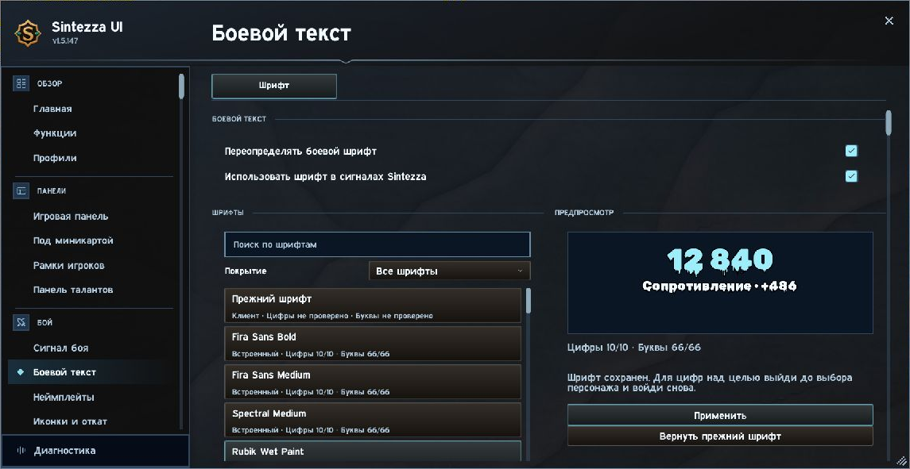
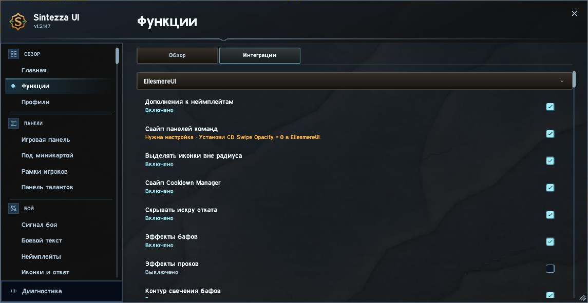

# Sintezza UI


Sintezza UI adds a game bar, combat and stealth alerts, raid tools, and map and nameplate controls to WoW Forever. It also extends the addons already handling your interface, including EllesmereUI, DandersFrames, OpenMap, and OpenXP. Open `/sui` to configure the modules and manage profiles.

## Installation

Install Sintezza UI and the required **[Sintezza Theme](https://github.com/ArtefactoO/Sintezza_Theme)** as separate folders in `Interface/AddOns`, then enable both. This release targets WoW Forever. The priest execute marker is available separately in **Sintezza Execute**.

## What it adds

- Game bar with system shortcuts, friends, guild, and a clock.
- Combat and stealth alerts with configurable text, graphics, and motion.
- Raid markers, ready checks, and pull controls.
- Group markers, personal waypoints, and transport timers when the map provides the data.
- Nameplate overlays for threat, the selected target, and aura rules.
- Combat font selection and previews, with shared interface and heading fonts managed in Sintezza Theme.

Under **Combat alert**, choose swords, a runic seal, a crest, embers, a slash, a flag, brackets, a fissure, or a side panel. The combat crest and flag use your character's faction emblem when available. The **Stealth** tab has a separate style picker with the original eye, footprints, a mask, and mist among its options. Edit the four messages for combat and stealth and preview them at their in-game positions. Signals can follow the active theme palette or use the manual colors stored in the profile.

The **Health** and **Aggro** tabs offer opt-in alerts with their own styles, captions, theme or manual colors, size, position, and preview. The health alert triggers when your health crosses the configured threshold and rearms once it recovers. The aggro alert triggers when you start holding enemy aggro in a dungeon or raid and rearms when you lose it. Both depend on the client making the readings available to addons.

| Command | Opens |
| --- | --- |
| `/sui` | Settings and profiles |
| `/sui fonts` | Combat text font and preview |
| `/sui report` | Client, module, and error diagnostics |
| `/sui npstatus` | Nameplate diagnostics |
| `/sui tipfont` | Active tooltip font and its last detected override |
| `/sui dida` | Does It Die Advanced mask diagnostics for the selected nameplate |
| `/sui whisperlog` | Recent filtered addon whisper errors and their sources |
| `/sgb` | Game bar controls |
| `/srt` | Raid tools controls |
| `/stheme` | Interface and heading fonts, palettes, and language |

## Combat text

Open `/sui fonts`, select a font in the preview, and click **Apply**. **Use font in Sintezza alerts** applies the choice to combat and stealth alerts immediately. Clear that option to use the fonts set in the alert module. To update numbers above targets after applying or restoring a font, return to character selection and log back in.

An enabled Sintezza override takes priority over the EllesmereUI combat font. The font settings flag when FontMagic controls combat numbers. The catalog includes WoW, Sintezza Theme, LibSharedMedia, and personal fonts. The Russian filter uses measured coverage of 66 Cyrillic letters. Entries without coverage data are marked unverified.

To add a personal font, put a copy in `Sintezza_UI/Media/CombatFonts/Custom` under a name from `1.ttf` to `20.ttf`, then restart WoW. The repository's optional tool `Tools/IndexCombatFonts.py` reads font names and Unicode coverage and can also index existing FontMagicCustomFonts slots. Run it again after replacing any numbered file. Its output and font copies live in the local `Sintezza_UI_LocalFonts` addon.

From the repository root, run the tool with the path to your own Forever installation.

```powershell
$addons = 'D:\Games\World of Warcraft\_forever_\Interface\AddOns'
python .\Tools\IndexCombatFonts.py $addons --output $addons
```

## Addon integrations

Open **Features → Integrations** to check optional addon dependencies and manage the Sintezza adapters. Click an addon name to expand or collapse its settings. The page shows when an addon or module is missing or disabled, an API or client is incompatible, or a change is pending a UI reload or character relog.

### Examples

**EllesmereUI nameplate example.** Set an aura rule for your specialization, then choose whether it colors the health bar, border, or supported text. A rule can require two debuffs or highlight the refresh window for a single DoT. Enable a separate outline for open-world aggro so the threat state stays visible alongside the aura color.

**OpenXP and Shortest Path example.** Enable the Sintezza waypoint and guide following in Shortest Path. When OpenXP advances to a supported step with a destination, Sintezza can pass that point to Shortest Path and use its walking route. The active OpenXP pointer can be hidden during routing and restored when the route ends.

### EllesmereUI

- **Nameplates.** Add an open-world aggro or near-aggro outline, optional health-bar tint, a scalable pattern on the selected target, and debuff color rules by class and specialization. Rules can color the health bar, border, or supported text, combine two debuffs, and highlight the refresh window for a single DoT. **Nameplates → General** can wrap buff icons at 3, 4, or 5 per row. **Text** adds outline and shadow controls for name, level, health, enemy target, quest progress, and cast labels. When Blizzard owns the visible plates, the fallback supports the target pattern, threat border, and aura rules. The Blizzard fallback yields to known nameplate replacements such as Plater and Platynator.
- **Action Bars.** **Icons and cooldowns → Cooldowns** adds shaped cooldown, GCD, and charge-recharge swipes with separate shading. Set **CD Swipe Opacity** to **0** in EllesmereUI and click **Apply** in Sintezza. On Forever, **Highlight out-of-range icons** can dim or tint icons on bars with EllesmereUI's **Out of Range Coloring** enabled.
- **Cooldown Manager.** Shape the swipes on supported icons, hide the cooldown spark, and add pulse, outline, or sound effects at up to four stack thresholds for a tracked buff. Rules can be limited to combat or grouped play. Proc effects can use a fill, outline, or both. Compatible procedural buff glows follow the icon shape selected in EllesmereUI.
- **Unit Frames, Raid Frames, Resource Bars, and the Action Bars experience bar.** **Unit frames → General / By element** gives supported widgets a shared or per-widget square or rounded shape, radius, dimensions, and border controls. This includes the player, target, focus, target-of-target, pet, boss and group frames, nameplates, health and power bars, class resource, and XP bar, subject to each widget's supported controls. The XP bar can inherit corner settings from the primary resource bar. **Apply to all** writes a thin black border to the supported widgets in the active EllesmereUI and DandersFrames profiles.
- **Aura Buff Reminders.** Compatible procedural glows follow the outline of shaped reminder icons.
- **Damage Meters.** On Forever, the meter formatter keeps one decimal digit for supported values below 1, such as `0.6`.
- **Forever Essentials.** Sintezza's talents and spellbook shortcuts use the EllesmereUI route when available, with the Blizzard micro buttons as fallback.
- **Shared glow.** The Game bar and Raid Check can use the EllesmereUI glow renderer for their own outlines when the glow border is selected.
- **Blizzard Skin and Mastercraft.** When EllesmereUI's custom tooltips are active, Sintezza reapplies its font, size, and outline to lines added to the game or item-link tooltip. Mastercraft's extra price and advice lines use the same typography. `/sui tipfont` shows the active font and the last detected overwrite.
- **Combat font.** The enabled Sintezza override takes priority over the EllesmereUI combat font. See **Combat text** above for the relog required by the numbers above targets.

EllesmereUI also served as a visual reference for Sintezza UI. [EllesmereUI](https://www.curseforge.com/wow/addons/ellesmereui)

### DandersFrames, fonts, and other overlays

- **DandersFrames.** **Unit frames → DandersFrames** edits party and raid layouts separately in their active profiles. Pick a solid, gradient, or texture border and adjust thickness, outward offset, color source, and opacity. Rounded frames can carry the matching dispel outline and compatible aggro glow. **Features → Integrations → DandersFrames → Absorb inset** keeps selected outer-glow presets from shrinking absorb and heal-absorb bars. [Danders Frames](https://www.curseforge.com/wow/addons/danders-frames)
- **LibSharedMedia and SharedMediaAdditionalFonts.** **Unit frames → Fonts → Register fonts** marks selected SharedMedia fonts as supporting the Latin and Cyrillic alphabets for DandersFrames. Select fonts that display the sample correctly and use `/reload` after removing a registration. SharedMedia also supplies fonts for the combat font catalog and raid tools. **Features → Integrations → Frame textures in SharedMedia** makes Sintezza's rounded glow and the Ellesmere glow available to media pickers when the corresponding addon is loaded.
- **TacoTip.** On Forever, the item-level and GearScore labels and values in the compatible character-window footer use the Sintezza Theme interface font. TacoTip supplies the footer and the scores.
- **Does It Die Advanced.** Its DoT forecast can be clipped to the rounded silhouette of the EllesmereUI target frame and supported EllesmereUI nameplates. The forecast retains its own fill, outline, and animations. Use `/sui dida` with a visible target plate to diagnose the mask. [Does It Die Advanced](https://www.curseforge.com/wow/addons/does-it-die-advanced)
- **FontMagic and FontMagicCustomFonts.** Sintezza reports when FontMagic owns the combat numbers. Valid files in the FontMagicCustomFonts numbered slots can appear in the Sintezza catalog or be indexed by the optional tool above.

### Maps, guides, and chat in WoW Forever

Find the map options under **Map** and the party controls under **Party on the map**.

- **Map tabs.** Enable **Stack right-side tabs** to place Muddy Boots below the native and ForeverCore tabs.
- **OpenMap.** Party positions and the party finder work on the stitched world map. Pick a teammate in the map menu to focus their marker, or their zone when only the zone is known. Sintezza's personal waypoint can be set from OpenMap as well as from the world-map canvas.
- **Shortest Path Forever.** **Sintezza UI waypoint** lets Ctrl + left-click set a personal waypoint and start a route through the compatible Shortest Path API. Ctrl + right-click clears the point and can also clear the temporary OpenMap pin and active **WaypointUI** user navigation. **Shortest Path route** replaces the walking route display with animated gold dots on both maps. This visual option is off by default and currently targets **v1.37.1**. The two transport timer options use Shortest Path observations to show arrival and departure countdowns beside supported dock markers, including on the stitched OpenMap view where available. `/sui report` reports route integration status and point counts. [Shortest Path Forever](https://www.curseforge.com/wow/addons/shortest-path-forever) · [OpenMap](https://www.curseforge.com/wow/addons/openmap)
- **OpenXP and Questie.** On the Russian Forever client, compatible OpenXP cards use Russian headings and standard step phrases. Matching quest, creature, object, item, and zone names are taken from client data, the OpenXP dictionary, or optional QuestieDB records. Free-form guide text keeps its original language. With the Sintezza personal waypoint and Shortest Path's RestedXP guide following enabled, Shortest Path can route to the current OpenXP step. Its **Hide RestedXP arrow** option can also hide the OpenXP pointer during that route, with visibility handed back when the journey ends. An active **RestedXP** integration keeps ownership of its own guide route. [OpenXP](https://www.curseforge.com/wow/addons/openxp-free-leveling-guides-for-wow-forever)
- **FlowUp and ForeverGuide.** With **Sintezza UI waypoint** turned on, compatible single guide destinations can become Sintezza waypoints and feed Shortest Path. The adapter also accepts supported temporary markers from their TomTom-compatible bridge when standalone **TomTom** is absent. Multi-point ForeverGuide batches stay with the original provider.
- **Lueur.** **Features → Integrations → Lueur → Highlighting outside combat** enables Lueur's hide-in-combat and exclusive highlighting settings through its own controls. Disabling the option restores the values Sintezza changed. [Lueur](https://www.curseforge.com/wow/addons/lueur)
- **Addon whispers.** **Features → Integrations → Sintezza UI → Hide addon whisper errors** filters missing-recipient errors matched to addon whispers when a manual whisper to the same player was absent. `/sui whisperlog` identifies known prefixes from ForeverGuide, FlowUp, OpenMap, and Shortest Path Forever, and shows the technical prefix for other tracked sends.

### Other Sintezza addons and Retail compatibility

- **Sintezza Rivals.** Its fight-marker toggle docks beneath the Sintezza UI party map button when the latter is visible.
- **Sintezza Execute.** The separate execute addon can import the saved appearance of the old execute marker from Sintezza UI when setting up its own database.
- **EllesmereUIQoL, Retail only.** Sintezza's dungeon teleport reminder defers to the EllesmereUIQoL **LFG Reminder** when that feature is active, avoiding a duplicate prompt.

## По-русски

Установи Sintezza UI и обязательный **Sintezza Theme** отдельными папками в `Interface/AddOns`. Этот выпуск предназначен для WoW Forever. Команда `/sui` открывает настройки игровой панели, сигналов боя и скрытности, рейдовых инструментов, карты и неймплейтов. Риска и значок добивания жреца доступны отдельно в **Sintezza Execute**. Команды модулей приведены в таблице выше.

В разделе **Сигнал боя** доступны мечи, рунная печать, герб, искры, взмах, знамя, скобы, трещина и плашка. Герб и знамя показывают эмблему фракции персонажа, когда она доступна. На вкладке **Скрытность** есть отдельный список стилей, включая исходный глаз, следы, маску и дымку. Четыре фразы для боя и скрытности можно менять и проверять на месте появления сигнала. Цвета берутся из активной темы или настраиваются вручную.

На вкладках **Здоровье** и **Агро** можно включить отдельные сигналы и настроить стиль, текст, размер, положение и цвета. Здоровье предупреждает один раз при пересечении выбранного порога и готово сработать снова после восстановления. В подземелье или рейде сигнал агро появляется, когда персонаж начинает удерживать агро, и снова готов после его потери. Сигналы работают там, где клиент отдает аддонам нужные значения. Предпросмотр доступен в настройках.

На вкладке **Функции → Интеграции** нажми на название аддона, чтобы развернуть или свернуть его настройки. Внутри видны результаты проверки зависимостей, переключатели адаптеров Sintezza и необходимость `/reload` или повторного входа.

### Боевой текст

Открой `/sui fonts`, выбери гарнитуру в предпросмотре и нажми **Применить**. Флажок **Использовать шрифт в сигналах Sintezza** сразу применяет выбор к сигналам боя и скрытности. Сними его, чтобы использовать отдельные шрифты модуля сигналов. Чтобы обновить цифры над целью после применения или возврата шрифта, выйди до выбора персонажа и войди снова.

Включенное переопределение Sintezza имеет приоритет над боевым шрифтом EllesmereUI. Окно настройки сообщает, если боевыми числами управляет FontMagic. Фильтр русского языка использует измеренное покрытие 66 кириллических букв. Общий шрифт интерфейса и шрифт заголовков настраиваются через `/stheme`.

Для личных гарнитур скопируй файлы в `Sintezza_UI/Media/CombatFonts/Custom` под именами от `1.ttf` до `20.ttf` и перезапусти WoW. Скрипт исходного репозитория `Tools/IndexCombatFonts.py` также читает слоты FontMagicCustomFonts и собирает имена шрифтов и покрытие Unicode в локальный каталог `Sintezza_UI_LocalFonts`. Команда запуска приведена выше.

### EllesmereUI

- **Неймплейты.** Контур агро и предупреждение о близком агро в открытом мире, отдельная окраска полосы здоровья, масштабируемый узор выбранной цели и правила дебаффов для класса и специализации. Правило может окрашивать полосу, рамку и поддерживаемые подписи, учитывать сочетание двух дебаффов или подсвечивать окно обновления одного эффекта. В разделе **Неймплейты → Основное** можно переносить баффы по 3, 4 или 5 иконок. На вкладке **Текст** отдельно настраиваются контур и тень имени, уровня, здоровья, цели моба, прогресса задания и подписей полосы заклинания. На штатных неймплейтах доступны узор цели, контур агро и правила аур.
- **Панели команд.** В разделе **Иконки и откат → Откат** доступны свайпы по форме иконки с раздельной яркостью обычного отката и GCD, а также перезарядки зарядов. В EllesmereUI установи **CD Swipe Opacity** в **0**, затем нажми **Применить** в Sintezza. В Forever пункт **Выделять иконки вне радиуса** задает прозрачность и цвет на панелях с включенным **Out of Range Coloring**.
- **Cooldown Manager.** Свайп следует форме поддерживаемых иконок. Можно скрыть искру отката и настроить пульсацию, контур или звук. На каждый бафф доступно до четырех порогов стаков. Для правила доступны ограничения по бою и группе. Подсветка проков поддерживает заливку, контур или оба эффекта. Совместимые процедурные свечения баффов повторяют форму иконок.
- **Рамки игроков и рейда, полосы ресурсов и опыта.** В разделе **Рамки игроков → Общее / По элементам** можно задать общую или отдельную форму, радиус, размеры и окантовку доступных элементов. Это рамки игрока, цели, фокуса, их целей, питомца, боссов и группы, неймплейты, полосы здоровья, ресурсов и опыта. Доступность отдельных настроек зависит от типа рамки. Полоса опыта может наследовать скругление основного ресурса. Кнопка **Применить ко всем** записывает тонкую черную окантовку в активные профили EllesmereUI и DandersFrames.
- **Aura Buff Reminders.** Совместимое процедурное свечение повторяет форму иконки напоминания.
- **Damage Meters.** На Forever форматирование поддерживаемых значений меньше единицы сохраняет один знак после запятой, например `0,6`.
- **Forever Essentials.** Кнопки талантов и книги заклинаний на панели Sintezza используют переход EllesmereUI, если он доступен, или штатные кнопки Blizzard.
- **Общее свечение.** Игровая панель и окно проверки рейда могут использовать отрисовку EllesmereUI, если для их окантовки выбрано свечение.
- **Blizzard Skin и Mastercraft.** Когда оформление подсказок EllesmereUI включено, Sintezza восстанавливает его шрифт, размер и контур в добавленных строках игровых подсказок и ссылок на предметы. Это касается и строк цен и рекомендаций Mastercraft. `/sui tipfont` показывает активный шрифт и источник последней обнаруженной замены.
- **Боевой шрифт.** Включенное переопределение Sintezza применяется поверх выбора EllesmereUI. Для цифр над целью действует описанный выше порядок повторного входа.

### DandersFrames, шрифты и дополнительные слои

- **DandersFrames.** В разделе **Рамки игроков → DandersFrames** оформление группы и рейда редактируется раздельно в их активных профилях. Можно выбрать сплошную рамку, градиент или текстуру, настроить толщину, вынос, источник цвета и прозрачность. Скругленные рамки могут сохранять подходящий контур снятия дебаффов и свечение агро. Пункт **Функции → Интеграции → DandersFrames → Отступ полосы поглощения** убирает лишний внутренний отступ у полос поглощения урона и лечения для поддерживаемых рамок с внешним свечением.
- **LibSharedMedia и SharedMediaAdditionalFonts.** В разделе **Рамки игроков → Шрифты** можно зарегистрировать выбранные гарнитуры SharedMedia для латиницы и кириллицы в DandersFrames. Проверяй кириллический образец при выборе. Для удаления регистрации используй `/reload`. SharedMedia также добавляет шрифты в каталог боевого текста и настройки рейдовых инструментов. Переключатель **Текстуры рамок в SharedMedia** регистрирует скругленное свечение Sintezza и, при наличии EllesmereUI, его свечение.
- **TacoTip.** В совместимой версии для Forever подписи и значения уровня предметов и GearScore внизу окна персонажа используют шрифт интерфейса Sintezza Theme. Содержимое и расчеты предоставляет TacoTip.
- **Does It Die Advanced.** Полоса прогноза урона DoT обрезается по скруглению рамки цели и поддерживаемых неймплейтов EllesmereUI. Заливка, контур и анимации принадлежат Does It Die Advanced. Состояние маски видно в `/sui dida` при выбранной цели с видимым неймплейтом.
- **FontMagic и FontMagicCustomFonts.** Sintezza показывает, когда боевыми цифрами управляет FontMagic. Доступные файлы из пронумерованных слотов FontMagicCustomFonts можно использовать из каталога или получить их названия и покрытие через индексатор.

### Карта, гайды и чат в WoW Forever

В разделе **Группа и карта** страница **Карта** содержит настройки вкладок, личной метки, маршрутов и транспорта. Настройки сопартийцев находятся на странице **Группа на карте**.

- **Вкладки карты.** Переключатель **Разнести вкладки справа** ставит вкладки Muddy Boots под штатными вкладками и вкладками ForeverCore.
- **OpenMap.** Поиск сопартийцев и их метки работают на сшитой карте мира. Выбор игрока в меню переносит к его метке или в его зону, если доступны только данные о зоне. Личную метку Sintezza можно поставить и на карте OpenMap.
- **Shortest Path Forever.** Включи **Личная метка Sintezza UI**. Ctrl + ЛКМ ставит метку и может запустить маршрут через совместимый Shortest Path. Ctrl + ПКМ удаляет метку, временную точку OpenMap и активную пользовательскую навигацию **WaypointUI**, если они доступны. **Маршрут Shortest Path** заменяет отображение пешего маршрута анимированными золотыми точками на миникарте и карте мира. Эффект выключен по умолчанию и рассчитан на **v1.37.1**. Отдельные переключатели таймеров читают наблюдения Shortest Path и показывают время прибытия и отправления транспорта у поддерживаемых меток, в том числе на сшитой карте OpenMap. `/sui report` показывает состояние маршрута и число его точек.
- **OpenXP и Questie.** На русском клиенте Forever совместимые карточки OpenXP получают русские заголовки и типовые фразы. Названия заданий, существ, объектов, предметов и зон подставляются из клиента, словаря OpenXP и необязательной базы QuestieDB при совпадении данных. Свободный текст гайда сохраняется на исходном языке. При включенной личной метке и следовании гайдам RestedXP в Shortest Path маршрут может вести к текущему шагу OpenXP. Пункт **Скрыть стрелку RestedXP** скрывает указатель OpenXP на время маршрута. Действующая интеграция RestedXP управляет собственным маршрутом.
- **FlowUp и ForeverGuide.** При включенной личной метке одиночная цель совместимого гайда может стать меткой Sintezza и запустить маршрут Shortest Path. Также поддерживается временная точка из совместимого моста, если отдельный **TomTom** не загружен. Пакеты меток ForeverGuide обрабатывает сам поставщик.
- **Lueur.** Переключатель **Функции → Интеграции → Lueur → Подсветка вне боя** включает в Lueur скрытие в бою и режим эксклюзивной подсветки. Выключение возвращает параметры, которые меняла Sintezza.
- **Служебные шепоты аддонов.** Пункт **Функции → Интеграции → Sintezza UI → Скрывать ошибки служебных шепотов** убирает ошибки отсутствующего получателя, если они связаны с шепотом аддона и этому же игроку не отправлялось ручное сообщение. `/sui whisperlog` показывает известные источники ForeverGuide, FlowUp, OpenMap, Shortest Path Forever и технические префиксы других отправителей.

### Другие аддоны Sintezza и совместимость с Retail

- **Sintezza Rivals.** Кнопка показа точек боев крепится под кнопкой группы Sintezza UI, когда та видима.
- **Sintezza Execute.** При первой настройке собственной базы может подхватить сохраненное оформление прежней риски добивания из профиля Sintezza UI.
- **EllesmereUIQoL, только Retail.** Если включен **LFG Reminder** EllesmereUIQoL, окно телепорта Sintezza уступает ему управление, чтобы не показалось второе напоминание.

## License

Sintezza's own source code is distributed under the MIT License. Rubik Wet Paint is distributed under the SIL Open Font License 1.1. The dock schedule table derives from Shortest Path Forever v1.37.1 transport data, which credits the WoW client tables and CMaNGOS classic-db spawn data. [MIT License](LICENSE) · [Rubik Wet Paint notice](Media/CombatFonts/RubikWetPaint-OFL.txt) · [Changelog](CHANGELOG.md) · [Shortest Path Forever](https://www.curseforge.com/wow/addons/shortest-path-forever)

## Gallery





[CurseForge listing fields](CURSEFORGE.md)
